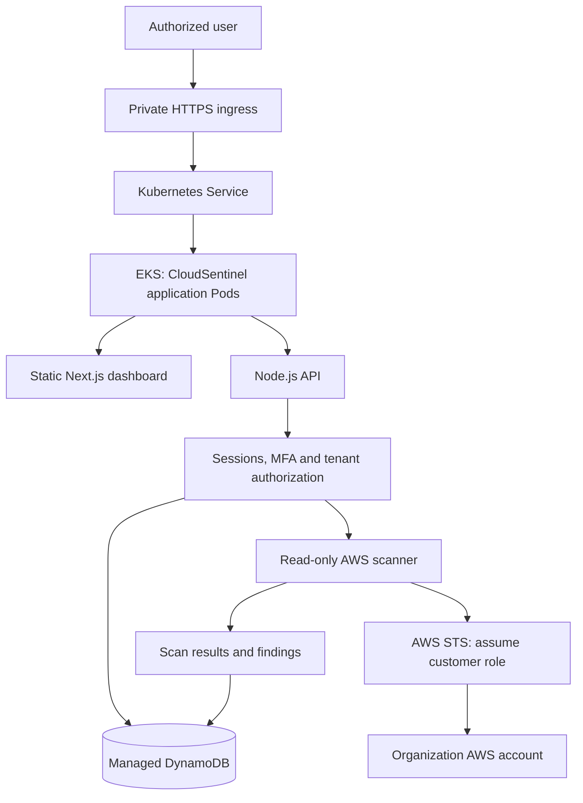
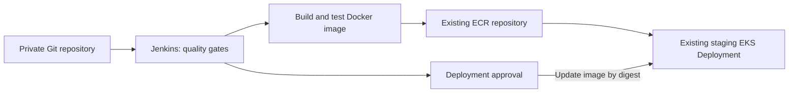

# CloudSentinel

Private cloud security platform for organization-level AWS configuration assessments.

**Status:** In development. Not production-ready. AWS deployment and Jenkins execution are not yet verified.

## Purpose

- Connect an organization’s AWS account through a restricted IAM role.
- Run predefined configuration checks.
- Review findings, evidence, severity, and remediation.
- Keep organization data and access separate.

## Deployment model

CloudSentinel requires configured infrastructure. It is not a standalone application.

| Component             | Responsibility                                                    |
| --------------------- | ----------------------------------------------------------------- |
| Docker image          | Packages the dashboard and Node.js API                            |
| Amazon ECR            | Stores versioned application images                               |
| Amazon EKS            | Runs and replaces application Pods                                |
| Kubernetes Service    | Routes requests to ready Pods                                     |
| Private HTTPS ingress | Provides access through the organization’s approved network       |
| Amazon DynamoDB       | Stores identities, sessions, connections, scans, and audit events |
| IAM runtime role      | Grants database access and permission to assume customer roles    |
| Shared MFA secret     | Encrypts authenticator seeds across application replicas          |
| Jenkins               | Tests, builds, publishes, and deploys approved releases           |

Private network access, HTTPS, IAM, and secrets must be configured by the operator.

## Application architecture



- The dashboard and API run together in one application container.
- Service directories are code boundaries, not separate deployed microservices.
- The database and MFA encryption key remain outside the application image.
- Current scans execute within the API request. A queue worker is not deployed.
- Lambda adapters also exist; the container deployment path uses the HTTP server.

## AWS account connection

1. The operator configures CloudSentinel’s AWS runtime identity.
2. An organization owner enrolls an authenticator and approves cloud actions.
3. CloudSentinel generates the IAM trust and read-permission policies.
4. The organization creates the IAM role in its own AWS account.
5. The owner submits the role ARN.
6. CloudSentinel verifies account identity and external-ID enforcement.
7. The owner runs a scan and reviews its findings.

Customer AWS access uses temporary STS credentials. The application does not collect customer access keys or change customer resources.

## Predefined checks

| Check                                                     | Severity |
| --------------------------------------------------------- | -------- |
| SSH open to unrestricted IPv4 or IPv6 sources             | High     |
| RDP open to unrestricted IPv4 or IPv6 sources             | High     |
| All-protocol ingress open to the internet                 | Critical |
| Missing or incomplete S3 bucket public-access protections | Medium   |
| S3 bucket policy classified as public                     | High     |

Findings describe configuration risks. Routing, account controls, and intended public workloads still require review.

## Scan limits

- One selected AWS region per connection.
- Up to 50 security groups and 25 general purpose S3 buckets per scan.
- A 20-second AWS request budget.
- Up to 5 scan-start attempts per organization per hour.
- Up to 10 connection records per organization, including disconnected records.
- Incomplete inventory, denied access, and timeouts are reported explicitly.

## Security controls

- Argon2id password hashing.
- HttpOnly session cookies; Secure cookies in AWS mode.
- Session expiration, logout, and revocation.
- TOTP MFA with encrypted seeds and replay protection.
- Owner-only cloud actions with 10-minute approval.
- Tenant and role checks on protected requests.
- Origin validation, CSRF protection, and authentication rate limits.
- Unique external IDs and restricted read-only STS session policies.

## Release architecture



## Jenkins pipeline

The [Jenkinsfile](Jenkinsfile) defines these stages:

1. Check out the commit.
2. Run formatting, type checks, lint, backend tests, and browser tests.
3. Build the runtime image.
4. Run container integration checks.
5. Optionally publish the image to ECR from the trusted `main` branch.
6. Request approval before updating the existing staging Deployment.
7. Wait for Kubernetes rollout readiness.

| Parameter        | Purpose                                   |
| ---------------- | ----------------------------------------- |
| `PUBLISH_TO_ECR` | Enable image publication; off by default  |
| `DEPLOY_TO_EKS`  | Enable staging deployment; off by default |
| `AWS_ACCOUNT_ID` | Account containing the ECR repository     |
| `AWS_REGION`     | Registry and cluster region               |
| `ECR_REPOSITORY` | Existing application image repository     |
| `EKS_CLUSTER`    | Existing staging cluster                  |

The agent requires the `docker` label, Docker/Buildx, Bash, and Git. Publication and deployment also require AWS CLI, kubectl, and authorized AWS/Kubernetes access.

Jenkins does not create the cluster, database, IAM roles, ingress, or application secrets.

## Private deployment requirements

1. Provision the approved network, EKS cluster, and ECR repository.
2. Create the DynamoDB table with string `pk` / `sk` keys and TTL on `expiresAt`.
3. Associate the application ServiceAccount with its runtime role through EKS Pod Identity.
4. Supply one persistent MFA encryption key through the managed secret workflow.
5. Configure private HTTPS ingress, DNS, and the exact application origin.
6. Replace the example values in the [EKS overlay](infrastructure/kubernetes/overlays/eks).
7. Review and apply the initial Kubernetes configuration.
8. Configure Jenkins for subsequent approved image releases.

The EKS manifests are templates. Private ingress, workload identity, and production controls are not provisioned by them.

## Runtime configuration

| Variable                          | Required value                                            |
| --------------------------------- | --------------------------------------------------------- |
| `APP_ENV`                         | `aws`                                                     |
| `APP_ORIGIN`                      | Exact private HTTPS origin, without a trailing slash      |
| `HOST`                            | `0.0.0.0` inside the container                            |
| `IDENTITY_TABLE`                  | Existing DynamoDB table name                              |
| `AWS_REGION`                      | Application table region                                  |
| `MFA_ENCRYPTION_KEY`              | Shared 64-character hexadecimal key from a managed secret |
| `CLOUDSENTINEL_AWS_PRINCIPAL_ARN` | Runtime IAM role trusted by customer roles                |

Use workload credentials. Keep AWS access keys and populated secrets out of Git and Docker images.

## Health and updates

- `/api/health`: process liveness.
- `/api/ready`: database read access.
- Kubernetes directs traffic only to ready application Pods.
- Rolling updates replace Pods while retaining database records.
- SIGTERM allows current requests to finish before shutdown.
- Application rollback changes the image version, not the database contents.

## Technology

| Area                     | Stack                                                |
| ------------------------ | ---------------------------------------------------- |
| Dashboard                | Next.js static export, React, Tailwind CSS, Radix UI |
| Backend                  | Node.js, TypeScript, Zod                             |
| Identity                 | Argon2id, server-side sessions, TOTP                 |
| Storage and cloud access | DynamoDB, AWS SDK, STS                               |
| Packaging and deployment | Docker, Kubernetes, ECR, EKS                         |
| Delivery and testing     | Jenkins, Vitest, Playwright, axe                     |

## Repository layout

```text
apps/dashboard/             Dashboard source
services/identity-service/   Authentication, MFA and API routing
services/connector-worker/   AWS readers and predefined checks
services/findings-service/   Connections, scan storage and summaries
packages/                   Shared schemas, storage and authorization
infrastructure/kubernetes/   Base, local-test and EKS manifests
infrastructure/terraform/    Reserved infrastructure boundaries
scripts/                    Runtime, database and container checks
tests/                      Backend, security and browser tests
Dockerfile                  Application and CI image stages
Jenkinsfile                 Build and release pipeline
```

## Verification and remaining work

**Verified in isolated development environments:**

- 32 backend/security tests and 10 desktop/mobile browser tests.
- Docker image and Compose integration checks.
- Kubernetes deployment and session/MFA persistence after Pod replacement.

**Still pending:**

- Live AWS scan verification and EKS deployment.
- Jenkins controller/agent execution.
- Email verification, password reset, and MFA recovery.
- Scheduled/background scans, retries, and broader AWS coverage.
- Member administration, incident management, and notifications.
- Production monitoring, backup/restore, and rollback exercises.

Essential architecture, deployment, CI/CD, scanning, security, and API notes are kept locally in `docs/`. That directory is excluded from Git; this README is the repository’s primary documentation.
